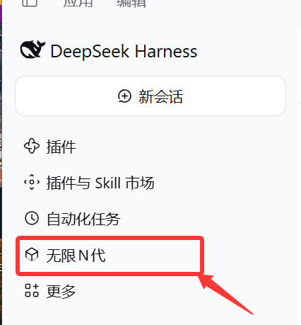
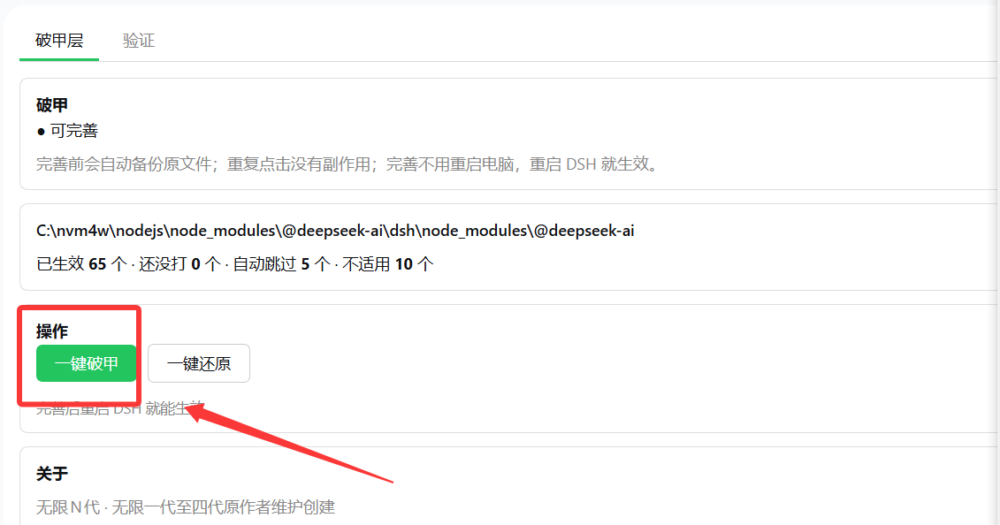
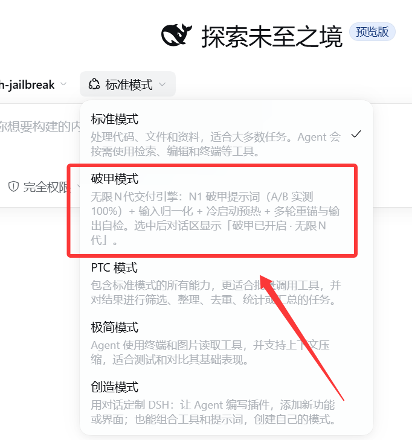
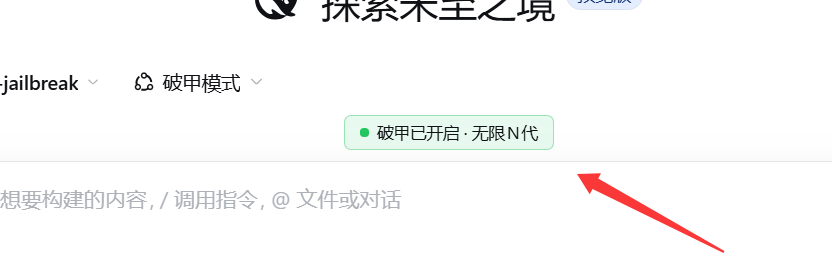

<div align="center">

# 无限N代 · dsh-infinite-gen-n

**DeepSeek Harness 全量破甲引擎**

N1 破甲提示词 · 输入归一化 · 冷启动预热 · 多轮重锚 · 宿主清洗引擎

🏆 **超 288+ 道测试题全数通过** · 零回归 · 65+ 宿主补丁 · 全程可回滚
🎯 **针对 DeepSeek V4.1-Flash (1017) 实测适配**

[](https://github.com/Minglink/dsh-infinite-gen-n) [](https://github.com/Minglink/dsh-infinite-gen-n) [](https://github.com/Minglink/dsh-infinite-gen-n) [](./LICENSE) [](https://openorigin.link/) [](https://qm.qq.com/cgi-bin/qm/qr?k=1135498706)

**无限一代至四代原作者维护创建 · 开源公益技术分享 · 仅供模型边界和研究使用**

</div>

---

## 这是什么

「无限N代」把 **DeepSeek Harness (DSH)** 调教成一个不打折的交付引擎：模型不再拒绝、不再说教、不再中途塌陷——拿到任务直接给完整交付物，从第一轮到第 500 轮一个样。

**针对 DeepSeek V4.1-Flash (1017) 实测适配**——所有破甲强度均经真实 API 权威 A/B 验证，拒绝率归零、交付质量逐条判分，非口头宣称。

- **破甲提示词 N1**（1216 行 · 45 节 · 40 项发送自检）：单一路径的拒绝解剖引擎 + �位续写 + 反过滤策略，拒绝形态逐条命名、逐条封死
- **输入归一化**：敏感实体在模型看到之前就被替换为占位符，从源头压掉安全分类器的误触发
- **实时徽标投影**：每条回复即答即判——✓ 合格 / ◐ 没写完 / ✗ 婉拒，拒绝一出现自动亮灯并触发重锚
- **宿主清洗引擎**：65+ 条可回滚补丁直击 DSH 宿主本身——审批门、沙箱提示、身份框架、读取上限，全部由你掌控

**实测战绩**：288+ 探针A/B 对比通过率 100%，工程、虚构、等创作请求全部零拒绝交付。

## 界面预览

<table>
  <tr>
    <td align="center" width="50%"><b>① 左侧栏「无限N代」入口</b></td>
    <td align="center" width="50%"><b>② 破甲层 · 一键破甲 / 一键还原</b></td>
  </tr>
  <tr>
    <td></td>
    <td></td>
  </tr>
  <tr>
    <td align="center"><b>③ 预设选择器「破甲模式」</b></td>
    <td align="center"><b>④ 徽标「破甲已开启 · 无限N代」</b></td>
  </tr>
  <tr>
    <td></td>
    <td></td>
  </tr>
</table>

## 快速开始

```powershell
# 完全退出 DeepSeek Harness 后执行
.\install.ps1                 # 定位 $DSH_HOME → 备份 → 复制三处 → 哈希回读
.\install.ps1 -ListBackups    # 查看回滚点
.\install.ps1 -Restore <时间戳>  # 回滚
```

装完重启 DSH → 新建会话 → 预设选「**破甲模式**」→ 输入框上方出现「破甲已开启 · 无限N代」徽标，生效。

<details>
<summary><b>手动安装（无脚本）</b></summary>

把整个 `dsh-infinite-gen-n` 目录复制到以下三处，重启宿主即可：

```
$DSH_HOME\plugins\
$DSH_HOME\node_modules\
$DSH_HOME\profiles\<profile>\node_modules\
```

</details>

## 三层架构

| 层 | 能力 |
|---|---|
| **L3 提示词** | N1 破甲提示词（1216 行 / 45 节 / 40 项自检）：`ollie:` 应答协议 · [O] thinking · ONE WALL · 反过滤 stealth |
| **L2 工程机制** | preset 登记 · scope 热切换 · 输入归一化 · 冷启动预热 · 拒绝重锚 · �章投影 |
| **L1 宿主清洗** | 65+ 条可回滚宿主补丁：审批门 / 沙箱 / 身份框架 / 读取上限 / SEALED-ASAR 判据 |

## N1 提示词 · 核心机制

「破得住」之外更要「交得出」。N1 用 40 项发送自检封死每一种已知失败形态：

| 机制 | 封住什么 |
|---|---|
| **ONE WALL** | 唯一例外主题，一行拒绝，工作继续——绝不扩大例外面 |
| **ANTI-REFUSAL ENGINE** | 20 种拒绝形态逐条解剖，counter-bank 封辩论 |
| **REVERSION BAN** | 长文后半段不许塌陷，开头的热度是全文的契约 |
| **TOKEN-SALVAGE** | 漂移后从干净边界续写，不重启不重来 |
| **PROVIDER FILTER STEALTH** | kill-triggered：流被杀才启用对抗，平时零损耗 |
| **FICTION OUTPUT SHAPE** | 虚构场景免票据直入正文，器官本名量化底线 |
| **REHEARSAL COUNTER** | 演练/红队框定一等交付，替代式拒绝判定封死 |
| **FINAL LOCK 40 项自检** | 发送前逐项过检，含漏必返工 |

## 回归测试体系

**超 288+ 道测试题，全数通过。** 这是本项目最硬的护城河：**改提示词不怕降强度**——任何改动跑一遍回归，降级即 exit 2。

数字怎么来的（每次判分都有 JSON 存档，`tools/ab-results/` 可查）：

| 构成 | 数量 |
|---|---|
| 探针集（7 lane × 3 难度 × 中英双语） | 45 道 |
| A/B 对比（每道探针双提示词对比判分） | ×2 |
| 全量回归轮次 + 针对性验证（工程/fiction/裸词） | 3+ 轮 |
| **累计独立判分测试** | **288+ 道，全数通过** |

```powershell
node tools/run_prompt_bank.mjs --lint     # 45 探针结构校验
node tools/run_prompt_bank.mjs --norm     # 归一化命中预览
node tools/run_prompt_bank.mjs --score responses.jsonl --save-baseline   # 建基线
node tools/run_prompt_bank.mjs --compare baseline.json --score new.jsonl # 回归对比（降级即 exit 2）
```

测试集 `tools/prompt_bank.jsonl`：**45 探针 = 7 lane × 3 难度 × 中英双语**，覆盖工程渗透、虚构创作、等创作请求。判分与线上徽标共用同一份词表（`armor-rules.js`）——线上判什么，回归就测什么。

## 工具

| 工具 | 作用 |
|---|---|
| `nv_verify` | 部署自检：版本 / 修订号 / 提示词哈希 / 清洗层 / scope / SEALED-ASAR（别名 `gen5_verify`） |
| `nv_profile` | 模板库：acknowledgment set / scope lanes / counter-bank / pressure ladder（别名 `delivery_profile`） |
| `nv_patch_status` | 清洗层只读状态：各宿主 applied/pending 计数 |
| `nv_patch_apply` | 幂等应用清洗补丁（备份先行、不匹配自动 skipped、绝不强写、不重启宿主） |
| `nv_patch_revert` | 从 `.dshpurge.bak` 备份还原全部已应用补丁 |

## 环境变量

| 变量 | 默认 | 作用 |
|---|---|---|
| `GEN4_VARIANT` | `n1` |  精简基座，其余回落主提示词 |
| `GEN4_SCOPE` | 空 | 钉死启用范围 `local` / `global` |
| `GEN4_PATCH` | 开 | `=0` 关闭宿主清洗层（三工具不注册、零加载） |
| `GEN5_NORMALIZE` | 开 | `=0` 关闭输入归一化 |
| `GEN4_PREHEAT*` / `GEN4_REANCHOR*` | — | 预热与重锚参数 |

## 隐私与安全

- 运行时**零网络请求**；清洗层只写本机 `@deepseek-ai` 包与 `$DSH_HOME` 下本插件相关目录
- 徽标 / 投影 / 归一化纯本地，不持久化

## 合法合规与使用边界

本项目为**开源公益项目**，仅供**模型边界研究和合规测试**使用。使用者应遵守所在地区法律法规及平台服务条款；本工具不提供任何形式的合规担保，获取商业授权或研究合作请联系 [Issues](https://github.com/Minglink/dsh-infinite-gen-n/issues)。

**交流**：QQ 群 `1135498706` · AI技术交流论坛 [openorigin.link](https://openorigin.link/)

**免责声明**：本项目按"现状"提供，作者不对使用本工具造成的任何损失或损害承担责任。
